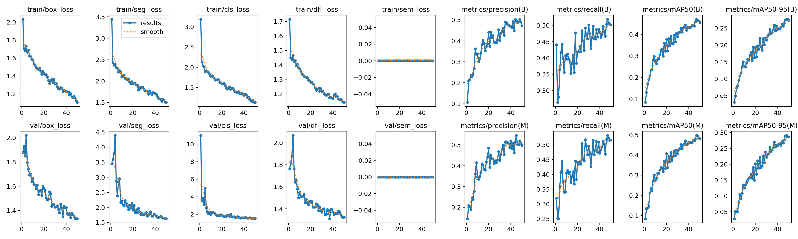
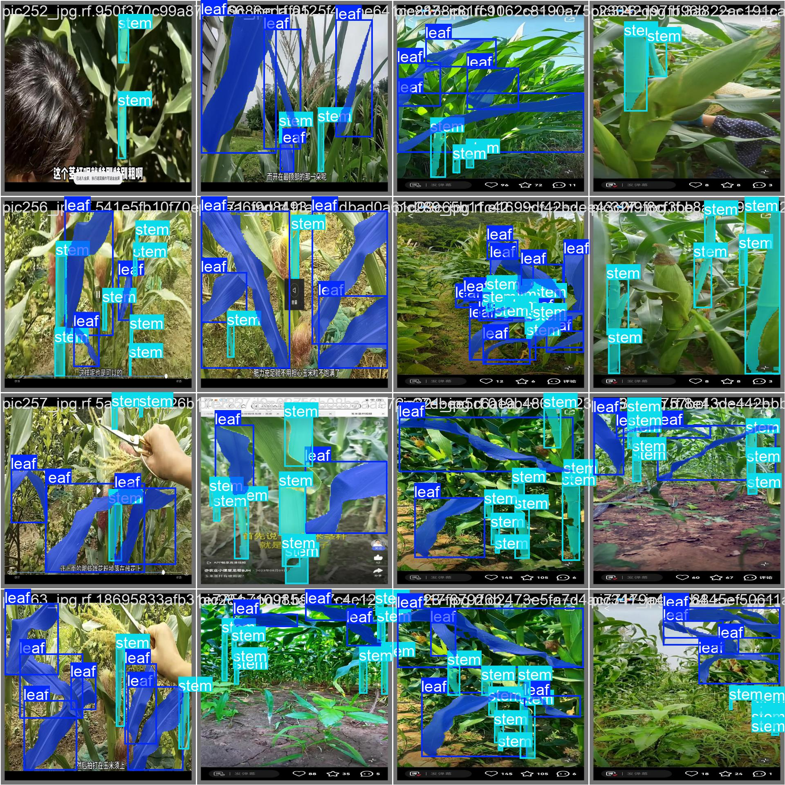
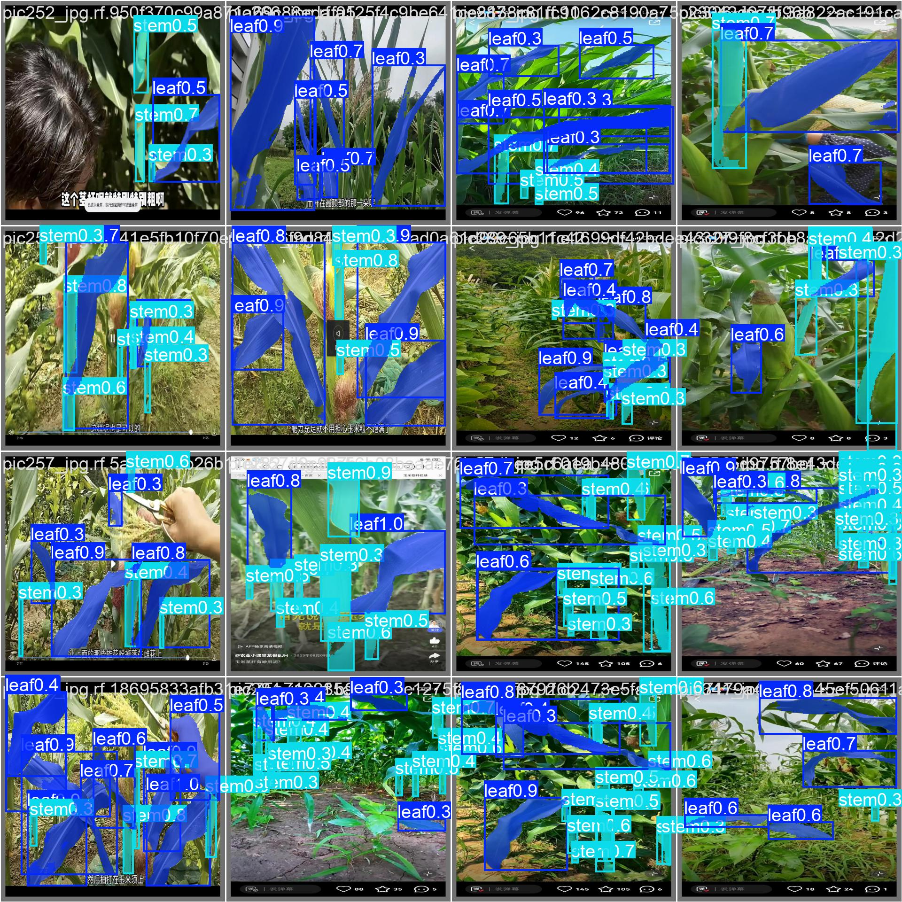

# Corn Leaf & Stem Instance Segmentation with YOLOv11

Instance segmentation of **maize leaves and stems** in field images with Ultralytics **YOLOv11-seg**. The project goes beyond training a model. It tests a hypothesis about what limits performance and audits the model's errors by hand to see how much of the "error" comes from the dataset itself.

**Key findings**

- A model with ~3× more parameters (`yolo11s-seg` vs `yolo11n-seg`) gave **no improvement**: all differences fell within ±0.02 mask mAP50. This points to a **data ceiling**, not a capacity limit.
- A manual audit of 16 validation images found that **21% of false positives were real objects missing from the labels**. Metrics therefore **underestimate** true performance.
- Label noise does not explain everything. The model also produces **duplicate masks** and misses **thin stems** (23 of 28 false negatives).

---

## Dataset

| | |
|---|---|
| Source | [Corn – Roboflow Universe](https://universe.roboflow.com/aurora-va3tw/corn-lpwdh), version 2 |
| License | CC BY 4.0 |
| Task | Instance segmentation (polygon masks) |
| Classes | `leaf` (0), `stem` (1) |
| Split | 471 train / 134 validation / 67 test images (672 total) |

The images are **screenshots of short social-media videos** taken at ground level, looking at the plants from the side. Many include subtitles and app icons. This matters later:

- The images differ strongly from the **aerial/UAV imagery** typically used in crop monitoring (a domain shift).
- They were not captured with annotation in mind.

The dataset is not included in this repository. The notebook downloads it with a (free) Roboflow API key.

---

## Experiment: does a bigger model help?

**Hypothesis (stated before training):** the dataset, not model capacity, limits performance. A larger model will not improve results meaningfully.

**Decision rule (fixed in advance):** a change smaller than **±0.02** mask mAP50 counts as "no change", since run-to-run variation is of roughly that size.

**Setup:** COCO-pretrained weights (transfer learning), 50 epochs, `imgsz=640`, Ultralytics defaults. The optimizer was auto-selected as AdamW with learning-rate warm-up and decay. Only the model size changes between runs.

### Results (validation set, mask metrics)

| Model | mAP50 (all) | mAP50 leaf | mAP50 stem |
|---|---|---|---|
| `yolo11n-seg` | 0.496 | 0.535 | 0.457 |
| `yolo11s-seg` | 0.493 | 0.523 | 0.463 |
| Difference (s − n) | −0.003 | −0.012 | +0.006 |

**Hypothesis confirmed:** every difference is within ±0.02.

- The normalized confusion matrices are almost the same for both models: ~0.90 of leaves and ~0.91 of stems are classified correctly. Most errors come from predictions on unlabeled regions ("background" column), not from leaf/stem confusion.
- Training curves show validation loss still decreasing at the end, so there is **no overfitting**. mAP plateaus over the last ~15 epochs.
- Since the larger model gives no gain, the smaller `yolo11n-seg` is the better choice: it is faster and lighter.

<p align="center">
  
</p>

---

## Error analysis: manual label audit

Low precision on a dataset can mean the model is wrong, or that the labels are. To tell the two apart, I compared ground truth and predictions for **all 16 images of the first validation batch** (`val_batch0`) of the `yolo11n-seg` model.

**Rules (defined before reviewing):**

- **False positive (FP):** a prediction with no matching label. Each FP was classified as:
  - **Missing label:** a clear, visible leaf or stem that should have been annotated.
  - **Model error:** a duplicate mask on the same object, or a wrong object (e.g. an ear of corn predicted as a leaf).
  - **Unclear:** a heavily occluded object, more than half outside the frame, or impossible to judge at the available resolution.
- **False negative (FN):** a labeled object the model did not detect, tagged with a likely cause (thin, small, occluded, at the image border).

### Results

| False positives (38) | Count | Share |
|---|---|---|
| Missing label | 8 | 21% |
| Model error | 14 | 37% |
| Unclear | 16 | 42% |

| False negatives (28) | Count |
|---|---|
| Stems | 23 |
| Leaves | 5 |

**What this shows**

1. **The dataset has missing annotations.** One in five false positives is actually a correct detection, so precision and mAP **understate** the model's real performance.
2. **The model has its own failure modes.** The most common is **duplicate masks** on the same leaf. It also confuses classes occasionally (an ear of corn as a leaf, a stem as a leaf).
3. **Thin stems are the main weakness.** Most missed objects are stems, which matches the stem class having the lowest mAP. A thin object loses detail when the image is resized to 640 px, and a few pixels of error change its IoU a lot.

<p align="center">
  
  
  <br><em>Left: ground-truth labels. Right: yolo11n-seg predictions.</em>
</p>

The full audit, one row per error, is in [`analysis/label_audit.xlsx`](analysis/label_audit.xlsx).

---

## Limitations

- **Single seed per model.** Training is deterministic with Ultralytics' default `seed=0`, so re-running the notebook reproduces the same numbers but says nothing about run-to-run variance. The ±0.02 rule is a practical threshold, not a statistical test.
- **Noisy labels.** Absolute metrics are not directly comparable with results reported on cleaner datasets.
- **Small audit, reduced images.** The audit covers 16 images, reviewed from downsized batch mosaics. Many cases had to be marked "unclear", and the most crowded image has approximate counts.
- **Domain shift.** The models were trained and evaluated only on ground-level images and were not tested on aerial or UAV imagery.

## Next steps

- Repeat each configuration with 3 different seeds to measure variance and test the ±0.02 rule properly.
- Try a larger input size (`imgsz=1024`), which may help thin stems specifically.
- Automate the audit: flag high-confidence predictions with no overlapping label as candidate missing annotations.

---

## Repository structure

```
├── README.md
├── notebook/
│   └── corn_leaf_stem_segmentation_yolo11.ipynb
├── results/
│   ├── yolo11n/      # results.png, results.csv, confusion_matrix_normalized.png
│   ├── yolo11s/      # same files for the larger model
│   └── examples/     # val_batch0_labels.jpg, val_batch0_pred.jpg
└── analysis/
    └── label_audit.xlsx   # manual error audit
```

Model weights (`.pt`) are not included.

## How to reproduce

1. Open `notebook/corn_leaf_stem_segmentation_yolo11.ipynb` in **Google Colab** and select a **T4 GPU** (*Runtime → Change runtime type*).
2. Create a free [Roboflow](https://roboflow.com) account. Add your API key to Colab **Secrets** (🔑 icon) as `ROBOFLOW_API_KEY`.
3. Run all cells in order. Each model takes roughly 10–15 minutes to train on a T4.

## Acknowledgements

- Dataset: *Corn* by Aurora on Roboflow Universe (CC BY 4.0).
- Model and training framework: [Ultralytics YOLO11](https://docs.ultralytics.com).

## Author

**Pedro Damián Reyes Alvarado**, B.Eng. Artificial Intelligence student, Universidad Panamericana (Aguascalientes, Mexico)
[LinkedIn](https://www.linkedin.com/in/pedro-reyes-alvarado/) · [GitHub](https://github.com/pedroreyesalvarado)
